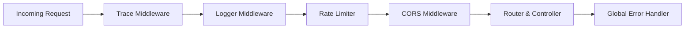

# 01. Routing & Middlewares

Manajemen lalu lintas HTTP dan middleware aplikasi ditangani oleh Fiber v3 yang didelegasikan melalui [`internal/app/router.go`](file:///home/melodelavic/Documents/golang/golang-fiber-starter-kit/internal/app/router.go).

---

## 🚦 Arsitektur Master Router Delegation

Aplikasi memisahkan lalu lintas menjadi 2 kelompok utama:

1. **Jalur Web SSR (Root Path):**
   Melayani request peramban web dan menyajikan HTML.
   - Contoh: `GET /example/cruds`, `GET /example/cruds/create`
2. **Jalur REST API (`/api/v1/*`):**
   Melayani request klien JSON dengan format respons standar envelope.
   - Contoh: `GET /api/v1/example/cruds`, `POST /api/v1/example/cruds`

Setiap modul domain mengimplementasikan interface `DomainRouter`:
```go
type DomainRouter interface {
    RegisterRoutes(web fiber.Router, api fiber.Router)
}
```

Pendaftaran seluruh modul domain dipusatkan di file [`internal/app/domains.go`](file:///home/melodelavic/Documents/golang/golang-fiber-starter-kit/internal/app/domains.go) menggunakan provider `NewModule()`:
```go
func RegisterAppDomains(c *Container) {
    sqlDB := c.DB.DefaultSQL()

    // 📦 Katalog Modul (Cukup 1 Baris per Modul):
    c.RegisterDomain(example.NewModule(sqlDB, c.Cache))
    c.RegisterDomain(user.NewModule(sqlDB, c.Cache))
}
```

Hal ini menjamin bahwa setiap modul domain bebas mendaftarkan rute Web maupun rute API tanpa menimbulkan bentrokan jalur (*route collisions*).

---

## 🛡️ Rangkaian Middleware Inti

Berikut urutan eksekusi middleware global yang aktif secara default:



### 1. Trace Correlation Middleware ([`internal/middleware/trace.go`](file:///home/melodelavic/Documents/golang/golang-fiber-starter-kit/internal/middleware/trace.go))
- Menangkap header `X-Correlation-ID` atau `X-Request-ID` yang dikirim dari klien / API Gateway.
- Jika tidak ada, otomatis membuat UUIDv4 unik baru.
- Menyematkan ID tersebut ke dalam konteks Go (`context.Context`) dan header respons HTTP `X-Correlation-ID`.

### 2. Request Logger Middleware ([`internal/middleware/logger.go`](file:///home/melodelavic/Documents/golang/golang-fiber-starter-kit/internal/middleware/logger.go))
- Mencatat metode HTTP, path, status response, durasi eksekusi (dalam ms), dan alamat IP klien.
- Terintegrasi dengan Trace Correlation ID sehingga setiap baris log request dapat dilacak dengan mudah.

### 3. Rate Limiter Middleware ([`internal/middleware/ratelimit.go`](file:///home/melodelavic/Documents/golang/golang-fiber-starter-kit/internal/middleware/ratelimit.go))
- Membatasi jumlah request dari satu IP klien untuk mencegah serangan brute force atau Denial of Service (DoS).
- Default: maksimum 100 request per menit.

### 4. Static Asset Serving ([`internal/app/router.go`](file:///home/melodelavic/Documents/golang/golang-fiber-starter-kit/internal/app/router.go))
- Menyajikan file publik (CSS, JS, favicon, gambar) dari direktori `./public` melalui endpoint `/public/*`:
  ```go
  app.Use("/public", static.New("./public"))
  ```
