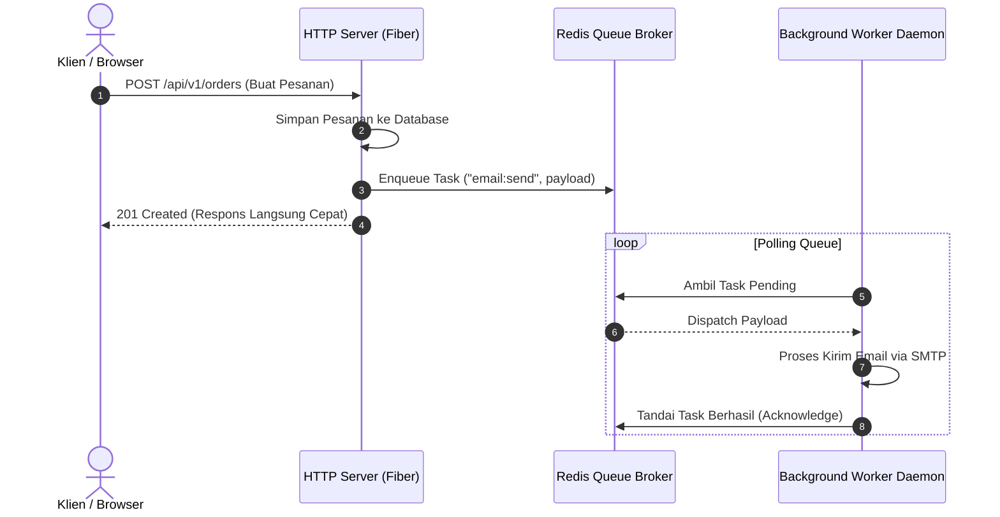

# 01. Asynq Queue & Worker Daemon

Untuk memproses pekerjaan yang memakan waktu (seperti pengiriman email, generate laporan PDF, atau sinkronisasi data eksternal), starter kit ini menyediakan antrean tugas latar belakang (*task queue*) berbasis Redis menggunakan [`hibiken/asynq`](https://github.com/hibiken/asynq).

---

## 🏛️ Arsitektur Pemrosesan Asinkron



---

## 🚀 Komponen Utama

1. **Client Dispatcher ([`pkg/queue/client.go`](file:///home/melodelavic/Documents/golang/golang-fiber-starter-kit/pkg/queue/client.go)):**
   Digunakan di dalam HTTP handler atau service untuk memasukkan pekerjaan ke antrean Redis:
   ```go
   task, err := queue.NewEmailSendTask(recipient, subject, htmlBody)
   if err == nil {
       _, err = queueClient.Enqueue(task, asynq.MaxRetry(3), asynq.Timeout(2*time.Minute))
   }
   ```

2. **Worker Daemon ([`cmd/worker/main.go`](file:///home/melodelavic/Documents/golang/golang-fiber-starter-kit/cmd/worker/main.go)):**
   Aplikasi Go mandiri yang dijalankan terpisah dari HTTP server:
   ```bash
   make worker
   ```
   Worker ini dapat di-scale secara horizontal ke beberapa instance/container server tanpa risiko perebutan tugas karena asynq mengelola locking task secara terdistribusi.

---

## ⚙️ Fitur Bawaan Asynq

- **Automatic Retries:** Otomatis mencoba ulang tugas yang gagal dengan exponential backoff.
- **Dead-Letter Queue:** Tugas yang gagal setelah batas retry maksimum disimpan untuk diinspeksi.
- **Scheduled Tasks:** Mendukung penundaan eksekusi tugas (misal: jalankan 10 menit ke depan menggunakan `asynq.ProcessIn(...)`).
- **Concurreny Control:** Batas jumlah goroutine pemrosesan dapat diatur di konfigurasi worker.
