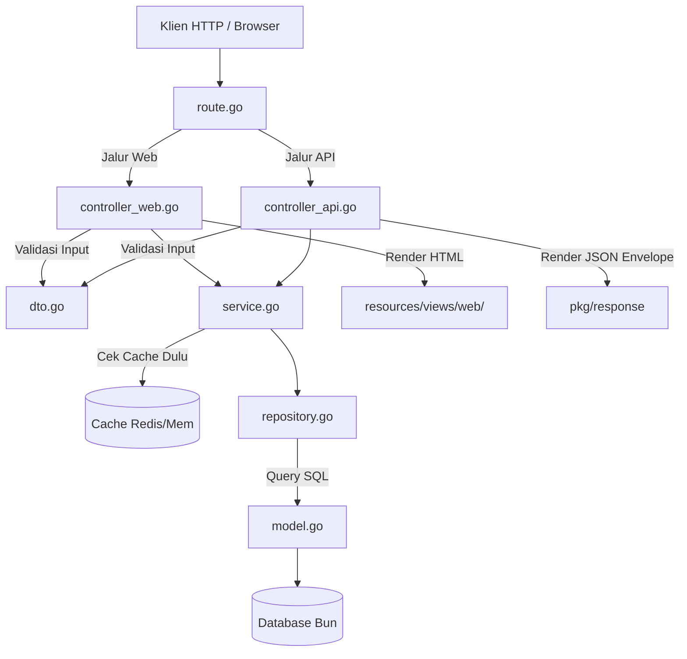

# 01. Domain Module Pattern (Clean Architecture)

Setiap fitur bisnis dalam starter kit ini dikelompokkan ke dalam satu modul domain independen di dalam direktori [`internal/domain/<nama_domain>/`](file:///home/melodelavic/Documents/golang/golang-fiber-starter-kit/internal/domain/example/).

Pola ini menerapkan prinsip **Clean Architecture & Separation of Concerns** sehingga kode tetap rapi, mudah diuji, dan tidak saling tumpang tindih.

---

## 🏛️ Anatomi File dalam Sebuah Modul Domain

Sebagai contoh referensi hidup, perhatikan struktur domain `internal/domain/example/`:

```text
internal/domain/example/
├── model.go            ← Definisi entitas database (Bun schema & tag struct)
├── dto.go              ← Data Transfer Objects (request/response validation)
├── repository.go       ← Interface & implementasi interaksi database SQL
├── service.go          ← Logika bisnis utama, orkestrasi cache & queue
├── controller_api.go   ← HTTP Handler untuk endpoint JSON REST API
├── controller_web.go   ← HTTP Handler untuk halaman Web HTML SSR (a-h/templ)
├── route.go            ← Registrasi rute Web dan API ke router utama Fiber
└── example_test.go     ← Unit test spesifik domain
```

---

## 🔄 Alur Tanggung Jawab (*Data Flow*)



---

## 📋 Peran Masing-Masing File

### 1. `model.go` (Database Entity)
Mendefinisikan skema tabel dan relasi menggunakan tag struct `uptrace/bun`:
```go
type ExampleCRUD struct {
    bun.BaseModel `bun:"table:cruds,alias:c"`

    ID          string     `bun:"id,pk,type:varchar(36)" json:"id"`
    Title       string     `bun:"title,notnull,type:varchar(255)" json:"title"`
    Description string     `bun:"description,type:text" json:"description"`
    Status      string     `bun:"status,notnull,default:'active'" json:"status"`
    CreatedAt   time.Time  `bun:"created_at,notnull" json:"created_at"`
    UpdatedAt   time.Time  `bun:"updated_at,notnull" json:"updated_at"`
    DeletedAt   *time.Time `bun:"deleted_at,soft_delete,nullzero" json:"-"`
}
```

### 2. `dto.go` (Input Validation)
Mendefinisikan format payload request dan validasi via `validator/v10`:
```go
type CreateRequest struct {
    Title       string `json:"title" form:"title" validate:"required,min=3,max=255"`
    Description string `json:"description" form:"description" validate:"omitempty,max=1000"`
    Status      string `json:"status" form:"status" validate:"omitempty,oneof=active inactive"`
}
```

### 3. `repository.go` (Database Interaction)
Memisahkan kueri database murni ke dalam interface sehingga mempermudah proses mocking saat testing:
```go
type Repository interface {
    FindAll(ctx context.Context) ([]ExampleCRUD, error)
    FindByID(ctx context.Context, id string) (*ExampleCRUD, error)
    Create(ctx context.Context, item *ExampleCRUD) error
    Delete(ctx context.Context, id string) error
}
```

### 4. `service.go` (Business Logic & Caching)
Menangani aturan bisnis, tag invalidation cache, dan pemanggilan antrean job:
```go
func (s *service) FindAll(ctx context.Context) ([]ExampleCRUD, error) {
    var items []ExampleCRUD
    // Cache hasil query selama 5 menit dengan tag invalidation
    err := s.cache.Remember(ctx, "example:items:all", 5*time.Minute, &items, func() (interface{}, error) {
        return s.repo.FindAll(ctx)
    })
    return items, err
}
```

### 5. `controller_api.go` & `controller_web.go`
- `controller_api.go`: Mengembalikan JSON seragam via `response.OK(...)` atau `response.Created(...)`.
- `controller_web.go`: Mengembalikan template server-side rendered `a-h/templ`.

### 6. `route.go` (Module Provider & Route Registrar)
Menyediakan fungsi perakitan mandiri `NewModule` dan mendaftarkan rute ke router Fiber:
```go
// NewModule merakit Repo, Service, Controller, dan Route secara internal
func NewModule(db *bun.DB, c cache.Cache) *RouteHandler {
    repo := NewRepository(db)
    svc := NewService(repo, c)
    webCtrl := NewWebController(svc)
    apiCtrl := NewAPIController(svc)
    return NewRouteHandler(webCtrl, apiCtrl)
}

func (h *RouteHandler) RegisterRoutes(web fiber.Router, api fiber.Router) {
    // 🖥️ 1. Jalur Web SSR (/example/cruds)
    webGroup := web.Group("/example/cruds")
    webGroup.Get("/", h.webCtrl.Index)
    webGroup.Get("/create", h.webCtrl.Create)
    webGroup.Post("/", h.webCtrl.Store)

    // 🔌 2. Jalur REST API (/api/v1/example/cruds)
    apiGroup := api.Group("/example/cruds")
    apiGroup.Get("/", h.apiCtrl.List)
    apiGroup.Post("/", h.apiCtrl.Create)
    apiGroup.Get("/:id", h.apiCtrl.GetByID)
    apiGroup.Put("/:id", h.apiCtrl.Update)
    apiGroup.Delete("/:id", h.apiCtrl.Delete)
}
```
