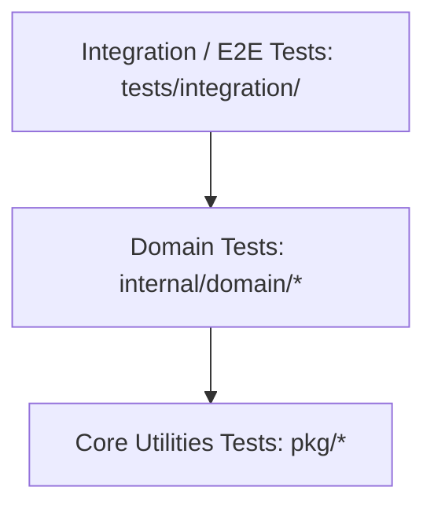

# 01. Strategi Pengujian (Testing Strategy)

Starter kit ini dibangun dengan filosofi *Test-Driven Confidence*. Seluruh lapisan kode dapat diuji secara otomatis dan cepat tanpa ketergantungan pada server eksternal berkat penggunaan driver SQLite in-memory murni.

---

## 🧪 Piramida Pengujian



1. **Unit Tests (`pkg/*` & `internal/domain/*`):**
   Menguji validasi, parsing konfigurasi, mapper respons, handler logger, dan logika bisnis service.
2. **Integration Tests (`tests/integration/*`):**
   Menguji seluruh siklus end-to-end: migrasi skema database Goose, middleware tracing, binding request HTTP Fiber, query database, hingga respons JSON envelope.

---

## ⚡ Eksekusi Pengujian Otomatis

Jalankan seluruh test suite dengan Race Condition Detector:
```bash
make test
```
Perintah ini di balik layar mengeksekusi:
```bash
templ generate
go test -v -race ./...
```

---

## 🛠️ Test Helper Harness (`tests/helpers/app.go`)

Paket [`tests/helpers`](file:///home/melodelavic/Documents/golang/golang-fiber-starter-kit/tests/helpers/app.go) menyediakan helper `SetupTestApp(t)` yang menyalakan instance aplikasi Fiber lengkap di memori:
- Menggunakan database SQLite in-memory terisolasi (`file::memory:?cache=shared`).
- Otomatis menjalankan file migrasi database Goose secara transaksional sebelum test dimulai.
- Menyediakan fungsi helper `ExecuteRequest(app, req)` untuk melakukan request HTTP virtual tanpa membuka port TCP jaringan fisik.

Contoh penulisan test integrasi:

```go
package integration_test

import (
    "net/http"
    "net/http/httptest"
    "testing"
    "github.com/stretchr/testify/assert"
    "golang-starter-kit/tests/helpers"
)

func TestHealthCheck(t *testing.T) {
    app, _ := helpers.SetupTestApp(t)

    req := httptest.NewRequest(http.MethodGet, "/api/v1/health", nil)
    resp, err := app.Server.Test(req)

    assert.NoError(t, err)
    assert.Equal(t, http.StatusOK, resp.StatusCode)
}
```
