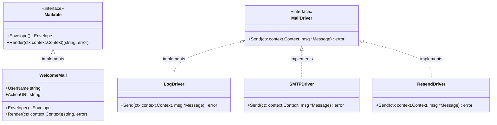

# 💡 Opsi Solusi 04: Laravel-Style Mail System & Templating

> **Status Keputusan:** ✅ **DECIDED: Opsi 1 (`a-h/templ`)**  
> **Keputusan:** Dipilih **`a-h/templ`** untuk sistem template HTML email agar mempertahankan keunggulan komponen modular dan 100% type-safety saat kompilasi (identik dengan pengalaman Hono JSX). Mail system mengadopsi interface `Mailable`, pre-rendering ke string sebelum enqueue ke Asynq, multi-driver (`log`, `smtp`, `resend`), dan fluent builder `mail.To().Queue()`.

---

## 🎯 Standar Production-Grade yang Harus Dipenuhi
1. **Pola Mailable Terstruktur:** Setiap email diwakili oleh struct mandiri yang menerima data input (props), mendefinisikan amplop (*Envelope: subject, from, to*), dan merender template tampilan.
2. **Pre-rendering Sebelum Enqueue:** Template email dirender menjadi string HTML statis sebelum dimasukkan ke antrean Redis. Hal ini mencegah dependensi siklus (*cyclic dependencies*) dan kegagalan unmarshaling struct pada sisi worker.
3. **Multi-Driver Transport:**
   - Driver `log`: Mencetak isi email lengkap dengan box ASCII ke console/log (aman saat dev & test tanpa risiko spam email nyata).
   - Driver `smtp`: Mengirim melalui protokol SMTP standar (`wneessen/go-mail`).
   - Driver `resend`: Mengirim melalui modern REST API Resend (`resend-go`).
4. **Fluent API:** Sintaks pemanggilan yang bersih dan ekspresif:
   ```go
   mail.To("user@domain.com").Queue(ctx, mail.NewWelcomeMail(user))
   ```

---

## 🏛️ Desain Mailable Idiomatik di Golang (Interface + Struct)

Karena Go tidak mendukung *class inheritance*, kita menggunakan **Interface Segregation**:



### 1. Kontrak Interface (`pkg/mail/mailable.go`):
```go
package mail

import "context"

type Envelope struct {
    Subject string
    From    string
    To      []string
    Cc      []string
    Bcc     []string
}

type Mailable interface {
    Envelope() Envelope
    Render(ctx context.Context) (string, error)
}
```

### 2. Implementasi Mailable Domain (`internal/mail/welcome.go`):
```go
package mail

type WelcomeMail struct {
    UserName  string
    ActionURL string
}

func NewWelcomeMail(userName, actionURL string) *WelcomeMail {
    return &WelcomeMail{UserName: userName, ActionURL: actionURL}
}

func (m *WelcomeMail) Envelope() mail.Envelope {
    return mail.Envelope{
        Subject: "Selamat Datang di Platform Kami!",
    }
}

func (m *WelcomeMail) Render(ctx context.Context) (string, error) {
    // Render via templ atau html/template
    return renderWelcomeHTML(ctx, m.UserName, m.ActionURL)
}
```

---

## ⚖️ Pilihan Engine Template Email HTML

### 🔹 Opsi 1: `a-h/templ` (Komponen JSX-Like Ber-Tipe Aman - SANGAT DIREKOMENDASIKAN)
- **Cara Kerja:** Menulis template berekstensi `.templ` yang dikompilasi menjadi fungsi Go murni.
- **Contoh Sintaks Template:**
  ```templ
  package emailviews

  templ WelcomeEmail(name string, actionURL string) {
      @EmailLayout("Selamat Datang") {
          <h1>Halo, { name }!</h1>
          <p>Terima kasih telah bergabung bersama kami.</p>
          <a href={ templ.SafeURL(actionURL) } class="btn">Mulai Sekarang</a>
      }
  }
  ```
- **Kelebihan:**
  - **Compile-Time Type Safety:** Kesalahan nama variabel atau tipe data langsung dicegat saat kompilasi.
  - Komposisi layout modular sama persis seperti Hono JSX (`resources/views/emails/layouts/EmailLayout.tsx`).
- **Kekurangan:** Membutuhkan satu perintah build tambahan (`templ generate`).

### 🔹 Opsi 2: Standar Library `html/template` + `//go:embed`
- **Cara Kerja:** Menulis file HTML dengan sintaks Go template `{{ .UserName }}`, lalu di-*embed* ke dalam binary Go saat build:
  ```go
  //go:embed templates/*.html
  var templateFS embed.FS
  ```
- **Kelebihan:** Zero external dependency (100% bawaan standar library Go).
- **Kekurangan:** Tidak type-safe saat kompilasi; rawan typo pada nama field yang baru ketahuan saat runtime.

---

## 🚀 Fluent Mail Facade (`pkg/mail/`)

Menyediakan antarmuka panggil ala Laravel yang ergonomis:

```go
// Pengiriman sinkron (langsung kirim via SMTP / Resend)
err := mail.To("john@example.com").Send(ctx, mail.NewWelcomeMail("John", "https://app.com"))

// Pengiriman asinkron (pre-render ke HTML -> enqueue ke Asynq / Redis)
err := mail.To("john@example.com").Queue(ctx, mail.NewWelcomeMail("John", "https://app.com"))
```

- Pada pemanggilan `.Queue()`, method `Render(ctx)` dieksekusi terlebih dahulu. String HTML yang sudah jadi beserta subjek dan alamat penerima dikirim ke antrean Asynq. Dengan cara ini, worker Asynq hanya bertugas mengirim payload data mentah tanpa perlu mengimpor kode template tampilan lagi.

---

## 📋 Rekomendasi Solusi & Bahan Diskusi:

| Kriteria | Opsi 1 (`a-h/templ`) | Opsi 2 (`html/template` Standar) |
|---|---|---|
| **Kemiripan Rasa dengan Hono JSX** | ⭐⭐⭐⭐⭐ (Sangat Mirip) | ⭐⭐⭐ (Sintaks Go lama) |
| **Keamanan Tipe & Autocomplete** | ⭐⭐⭐⭐⭐ (100% Compile-Time) | ⭐⭐ (Reflection runtime) |
| **Kemudahan Pembuatan Layout** | ⭐⭐⭐⭐⭐ (Komponen Modular) | ⭐⭐⭐ (Template inheritance) |
| **Dependensi Eksternal** | Butuh CLI `templ` | Zero Dependency (Bawaan Go) |

> 💬 **Bahan Diskusi Topik 4:**
> Apakah Anda lebih tertarik menggunakan **`a-h/templ`** untuk menjaga pengalaman templating berbasis komponen yang ber-tipe aman seperti Hono JSX, atau cukup menggunakan **`html/template`** bawaan Go?
