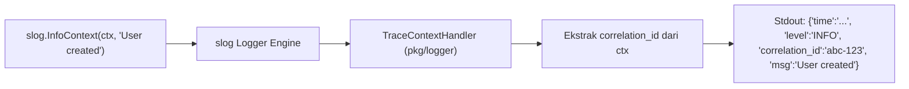

# 💡 Opsi Solusi 05: Caching, Structured Logging & Observabilitas

> **Status Keputusan:** ✅ **DECIDED: Standar Observabilitas Penuh**  
> **Keputusan:** Dipilih **`log/slog` bawaan Go 1.21+** dengan Custom Context Handler untuk logging otomatis berbasis `correlation_id` (zero external dependency). Caching menggunakan **`redis/go-redis/v9`** dengan pola `Remember` dan *Tag-based Invalidation*. Telemetri menggunakan **`prometheus/client_golang`** (`/metrics`), serta probe kesehatan mendalam di **`/api/health`**.

---

## 🎯 Standar Production-Grade yang Harus Dipenuhi
1. **Context-Bound Structured Logging:** Setiap baris log wajib secara otomatis mengikutsertakan `correlation_id` / `trace_id` yang tersimpan di dalam `ctx context.Context`, tanpa developer perlu mengetik `logger.With("trace_id", id)` secara berulang di setiap log.
2. **Unified Cache Abstraction:** Menyediakan pola *Cache-Aside* (`Remember`) dengan serialisasi JSON, TTL terukur, dan kemampuan *Tag-based Invalidation* untuk menghapus cache per domain sekaligus.
3. **Standar Metrik Prometheus:** Mengekspos endpoint `/metrics` yang menyajikan distribusi latensi (histogram), laju request (counter), serta metrik runtime internal Go (alokasi heap, durasi pause GC, jumlah goroutine).
4. **Deep Health Check Probes:** Endpoint `/api/health` yang dapat digunakan oleh Kubernetes/Docker untuk memverifikasi kesiapan (*readiness*) dan kelangsungan (*liveness*) aplikasi.

---

## 🪵 1. Structured Logging: `log/slog` dengan Context Handler

Mulai Go 1.21, pustaka standar menyediakan package **`log/slog`** yang berkinerja tinggi. Kita dapat mengimplementasikan **Context Handler kustom** di `pkg/logger/`:



### Implementasi Context Extraction:
```go
package logger

import (
    "context"
    "log/slog"
)

type TraceHandler struct {
    slog.Handler
}

func (h *TraceHandler) Handle(ctx context.Context, r slog.Record) error {
    if traceID, ok := ctx.Value("correlation_id").(string); ok && traceID != "" {
        r.AddAttrs(slog.String("correlation_id", traceID))
    }
    return h.Handler.Handle(ctx, r)
}
```
- **Hasil:** Developer cukup memanggil `slog.InfoContext(ctx, "Pesan...")`, dan seluruh log di controller, service, atau worker otomatis memiliki metadata pelacakan yang seragam!

---

## 🗄️ 2. Caching Layer: `go-redis/v9` + Tag-Based Invalidation

### Kontrak Cache Interface (`pkg/cache/cache.go`):
```go
package cache

import (
    "context"
    "time"
)

type Cache interface {
    Get(ctx context.Context, key string, dest any) error
    Set(ctx context.Context, key string, value any, ttl time.Duration) error
    Delete(ctx context.Context, key string) error
    Remember(ctx context.Context, key string, ttl time.Duration, dest any, fallback func() (any, error)) error
    InvalidateTag(ctx context.Context, tag string) error
}
```

### Mekanisme Tag-Based Invalidation di Redis:
1. Saat data disimpan dengan tag (misal: `tag:cruds`), key cache dicatat ke dalam Redis Set: `SADD tags:cruds "cache:cruds:1"`.
2. Saat terjadi mutasi data (Create/Update/Delete), Service cukup memanggil `cache.InvalidateTag(ctx, "cruds")`.
3. Semua key yang terdaftar di dalam Redis Set `tags:cruds` dihapus secara atomic via Redis Pipeline.

---

## 📈 3. Prometheus Telemetry (`prometheus/client_golang`)

Middleware HTTP otomatis merekam:
1. **`http_requests_total` (Counter):**
   - Label: `method`, `path`, `status_code`
2. **`http_request_duration_seconds` (Histogram):**
   - Buckets standar: `[0.005, 0.01, 0.025, 0.05, 0.1, 0.25, 0.5, 1, 2.5, 5, 10]`
3. **Runtime Metrics:** Otomatis dikumpulkan oleh Prometheus collector bawaan (CPU, Memory, Goroutines).

Endpoint `/metrics` dapat dilindungi oleh basic auth atau dibatasi hanya untuk internal monitoring network.

---

## 🩺 4. Health Check Probes (`/api/health`)

```go
func HealthCheckHandler(db *sql.DB, rdb *redis.Client) http.HandlerFunc {
    return func(w http.ResponseWriter, r *http.Request) {
        ctx, cancel := context.WithTimeout(r.Context(), 2*time.Second)
        defer cancel()

        dbStatus := "up"
        if err := db.PingContext(ctx); err != nil {
            dbStatus = "down"
        }

        redisStatus := "up"
        if err := rdb.Ping(ctx).Err(); err != nil {
            redisStatus = "down"
        }

        isHealthy := dbStatus == "up" && redisStatus == "up"
        statusCode := http.StatusOK
        if !isHealthy {
            statusCode = http.StatusServiceUnavailable
        }

        response.JSON(w, statusCode, map[string]any{
            "status": map[bool]string{true: "healthy", false: "unhealthy"}[isHealthy],
            "checks": map[string]string{
                "database": dbStatus,
                "redis":    redisStatus,
            },
        })
    }
}
```

---

## 📋 Rekomendasi Solusi & Bahan Diskusi:

> 💬 **Bahan Diskusi Topik 5:**
> Apakah Anda setuju menggunakan kombinasi **`log/slog` bawaan Go 1.21+** untuk logging kontekstual (tanpa dependensi luar yang berat), dipadukan dengan **`go-redis/v9`** dan **`prometheus/client_golang`**?
