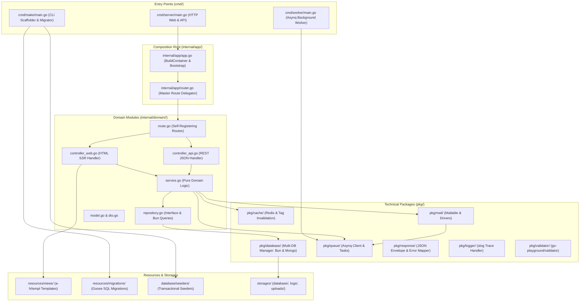
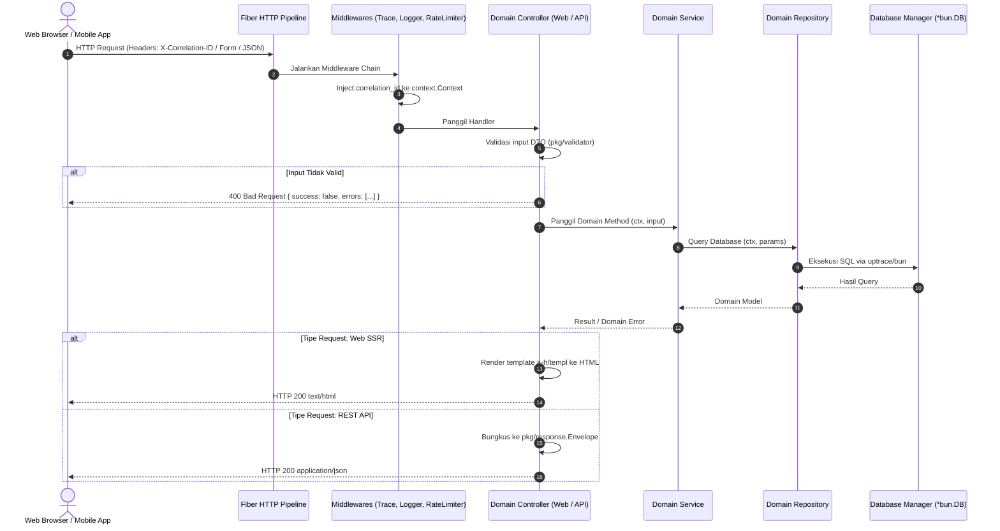
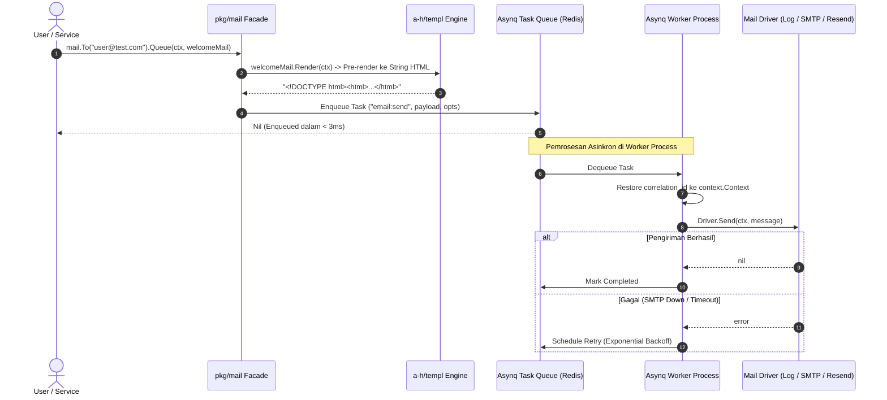

# 🏛️ Implementasi: 00 - Blueprint Teknis & Arsitektur Sistem

Dokumen ini memuat cetak biru teknis komprehensif, diagram relasi paket, dan alur data end-to-end untuk pembangunan **Golang Starter Kit** berbasis **Go-Fiber v3**, **uptrace/bun**, **hibiken/asynq**, **a-h/templ**, dan **log/slog**.

---

## 1. Diagram Arsitektur & Relasi Paket (Layer Dependency)

---

## 2. Alur Request HTTP (Web SSR & REST API)

---

## 3. Alur Background Worker & Mail Dispatch

---

## 4. Matriks Teknologi & Pustaka Utama

| Komponen Arsitektur | Teknologi / Pustaka | Alasan Pemilihan & Keunggulan |
|---|---|---|
| **Language & Runtime** | Golang 1.22+ | Static compilation (single binary), hemat RAM (~25MB), goroutines native |
| **HTTP Web Framework** | **Go-Fiber v3** | Engine `fasthttp` super cepat, sintaks 95% mirip Hono/Express, ekosistem middleware lengkap |
| **Relational Database** | **`uptrace/bun`** | SQL query builder fluent, mendukung `sqlite1..3`, `mysql1..3`, `pg1..3` dalam satu interface |
| **NoSQL Database** | **`mongo-driver/v2`** | Official MongoDB Go driver untuk `mongo1..3` |
| **Database Migrations** | **`pressly/goose`** | Standar industri migrasi SQL, mendukung migrasi terarah per database target |
| **Database Seeders** | **Custom Transactional Runner** | Seeder modular, dibungkus `RunInTx` dan *idempotent* (anti-duplikasi) |
| **Task Queue & Worker** | **`hibiken/asynq` + Redis** | Klon 1:1 BullMQ di Go, retries, exponential backoff, Web Dashboard `asynqmon` |
| **Email HTML Templates** | **`a-h/templ`** | Template berbasis komponen mirip JSX, 100% type-safe saat kompilasi |
| **Email Transports** | **`wneessen/go-mail` + Resend** | Multi-driver transport (`log`, `smtp`, `resend`), aman untuk dev/test |
| **Structured Logging** | **`log/slog` (Stdlib)** | Logging berkecepatan tinggi tanpa dependensi luar, otomatis membawa `correlation_id` |
| **Caching Layer** | **`redis/go-redis/v9`** | Pola Cache-Aside (`Remember`) dengan *Tag-based Invalidation* via Redis Sets |
| **Observabilitas** | **`prometheus/client_golang`** | Metrik standar Prometheus (`/metrics`) dan deep health check (`/api/v1/health`) |
| **Config & Env** | **`ilyakaznacheev/cleanenv`** | Fail-fast startup: otomatis validasi file `.env` dan tipe data variabel |
| **CLI Scaffolder** | **`cmd/make`** | Tool pembuat kode instan (module, controller, service, repo, mail, job, seeder) |
