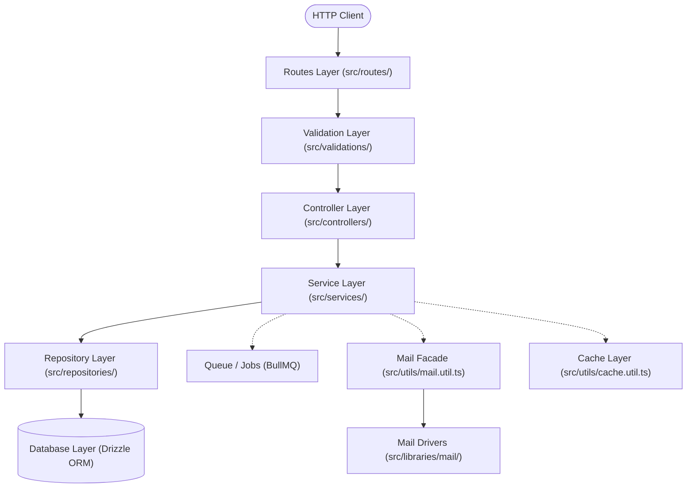
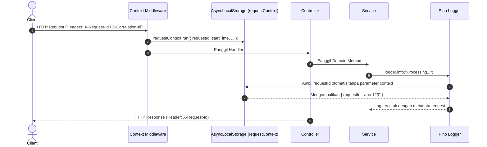

# 🏛️ Analisis Referensi: Core Architecture & Lifecycle Aplikasi

Dokumen ini membedah arsitektur dasar, batasan lapisan (*layer boundaries*), siklus hidup aplikasi, dan mekanisme penanganan error pada starter kit eksisting (`hono-skeleton-started-kit`).

---

## 1. Konsep Arsitektur: Modular Layered Architecture

Starter kit ini mengadopsi pola **Layered Architecture (N-Tier)** dengan pemisahan domain yang ketat. Aturan dependensi mengalir satu arah ke bawah:



### Aturan Batasan Tanggung Jawab (*Boundaries & Separation of Concerns*):
1. **Controllers (`src/controllers/`):**
   - Hanya berinteraksi dengan HTTP request dan response.
   - Mengambil input yang sudah divalidasi oleh Zod via `c.req.valid()`.
   - Meneruskan data ke Service dan mengembalikan response terstandarisasi (`successResponse()`).
   - Tidak boleh memuat business logic murni atau kueri database langsung.
2. **Services (`src/services/`):**
   - Tempat tinggal logika bisnis murni (*pure domain logic*).
   - Benar-benar terisolasi dari objek HTTP framework (tidak boleh mengimpor `Context` dari Hono).
   - Memanggil Repository untuk manipulasi data, memanggil `Mail` untuk notifikasi, atau `Queue` untuk tugas latar belakang.
   - Melempar (*throw*) domain exception (`AppError`, `NotFoundError`, dll) jika terjadi kegagalan aturan bisnis.
3. **Repositories (`src/repositories/`):**
   - Bertanggung jawab penuh terhadap akses data persistence (Drizzle ORM / SQL query).
   - Mengabstraksi koneksi database sehingga Service tidak perlu tahu detail SQL atau tabel.
4. **Libraries (`src/libraries/`):**
   - Berisi adapter teknis pihak ketiga tingkat rendah (misal: mail transport Nodemailer/Resend).
   - Agnostik terhadap domain aplikasi, murni menangani protokol I/O teknis.
5. **Utils (`src/utils/`):**
   - Helper dan facade global (Logger, Cache, Metrics, Mail facade, Response formatters).

---

## 2. Request Lifecycle & Context Propagation

Dalam ekosistem TypeScript/Node/Bun, konteks request disebarkan secara implisit tanpa harus mengoper parameter `context` ke setiap fungsi berkat `AsyncLocalStorage`:



- Komponen utama: `src/middlewares/common/context.middleware.ts` & `src/utils/context.util.ts`.
- Menyediakan pelacakan *Correlation ID* terpadu dari HTTP masuk hingga log dan background queue.

---

## 3. Global Error Handling & Response Envelope

Semua respons API dijamin memiliki struktur JSON seragam (*Uniform Envelope*):

### Format Response Sukses:
```json
{
  "success": true,
  "message": "Resource fetched successfully",
  "data": { ... },
  "meta": {
    "page": 1,
    "total": 100
  }
}
```

### Format Response Error:
```json
{
  "success": false,
  "message": "Validation failed",
  "errors": [
    {
      "field": "email",
      "message": "Invalid email address"
    }
  ],
  "meta": {
    "requestId": "req_01hz...abc",
    "timestamp": "2026-10-28T16:00:00.000Z"
  }
}
```

### Mekanisme Error:
- Hirarki class kustom di `src/utils/errors.util.ts`:
  - `AppError` (Base HTTP error dengan status code)
  - `BadRequestError` (400)
  - `UnauthorizedError` (401)
  - `ForbiddenError` (403)
  - `NotFoundError` (404)
  - `ConflictError` (409)
  - `UnprocessableEntityError` (422)
  - `InternalServerError` (500)
- Centralized Error Handler di `src/middlewares/common/errorHandler.ts`:
  - Menangkap semua uncaught exceptions.
  - Memetakan error Zod menjadi format error standar 400.
  - Menyembunyikan stack trace pada mode production demi keamanan.

---

## 4. Application Bootstrap & Graceful Shutdown

Alur startup aplikasi (`src/index.ts` & `src/app.ts`):
1. **Validasi Environment:** Memvalidasi konfigurasi via Zod sebelum server menyala (`src/configs/env.ts`).
2. **Koneksi Infrastruktur:** Inisialisasi pool koneksi database (SQLite/MySQL/PostgreSQL) dan Redis.
3. **Pendaftaran Middleware & Routes:** Global middleware didaftarkan secara berurutan.
4. **Graceful Shutdown:** Menangkap sinyal OS (`SIGINT`, `SIGTERM`), menutup koneksi database, menghentikan worker BullMQ dengan aman (*draining active jobs*), lalu menghentikan proses HTTP server.
