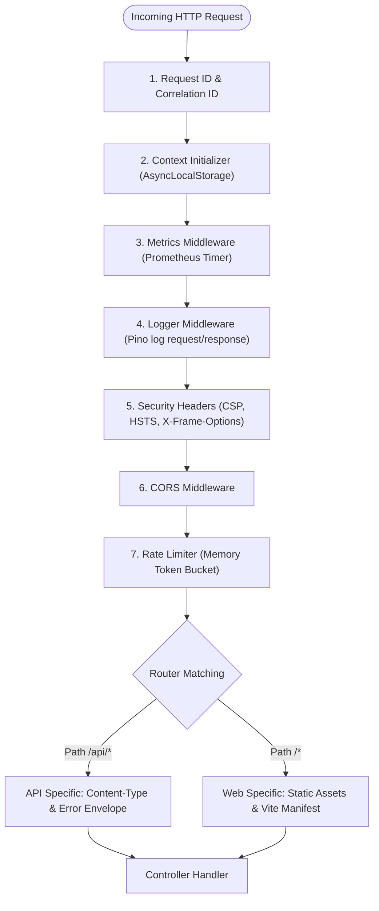

# 🌐 Analisis Referensi: HTTP Routing, OpenAPI & Middleware Pipeline

Dokumen ini membedah arsitektur routing ganda (API vs Web SSR), integrasi otomatis spesifikasi OpenAPI / Scalar Docs, serta rantai (*pipeline*) middleware.

---

## 1. Dual Routing Structure (API vs Web SSR)

Starter kit memisahkan secara fisik antara endpoint RESTful API dan antarmuka Web SSR:

```text
src/routes/
├── index.ts          # Mount agregat: menggabungkan /api dan /web
├── api/
│   ├── index.ts      # Mount router API (/api/*)
│   ├── docs/         # OpenAPI JSON spec (/api/docs/openapi.json) & UI (/api/docs)
│   ├── health/       # Health check probes (/api/health)
│   ├── metrics/      # Prometheus telemetry (/metrics)
│   └── example/      # Domain endpoint (misal: /api/example/cruds)
└── web/
    ├── index.ts      # Mount router Web (SSR)
    └── example/      # Tampilan Web SSR Hono JSX
```

---

## 2. OpenAPI Specification & Schema-First Validation

Starter kit menggunakan `@hono/zod-openapi` untuk menghubungkan validasi input, dokumentasi OpenAPI, dan definisi route dalam satu sumber kebenaran (*single source of truth*).

### Alur Definisi Route OpenAPI:
1. **Schema DTO (`src/validations/`):** Didefinisikan menggunakan Zod schemas dengan metadata OpenAPI (`openapi: { example: ..., description: ... }`).
2. **OpenAPI Route Spec (`createRoute`):**
   ```typescript
   export const createCrudRoute = createRoute({
     method: "post",
     path: "/api/example/cruds",
     request: {
       body: {
         content: {
           "application/json": { schema: CreateCrudBody }
         }
       }
     },
     responses: {
       201: {
         description: "Resource created",
         content: { "application/json": { schema: CrudResponseSchema } }
       },
       400: {
         description: "Validation error",
         content: { "application/json": { schema: ErrorResponseSchema } }
       }
     }
   });
   ```
3. **Dokumentasi UI:** Disajikan melalui **Scalar API Reference** (`@scalar/hono-api-reference`) pada route `/api/docs` yang membaca langsung OpenAPI 3.1 JSON dari `/api/docs/openapi.json`.

---

## 3. Middleware Pipeline

Pipeline middleware disusun dengan urutan eksekusi (*order of execution*) yang ketat:



### Rincian Middleware:
- **`context.middleware.ts`**: Menangkap header `X-Request-Id` (atau menghasilkan UUID baru) dan menyimpannya ke request context.
- **`logger.middleware.ts`**: Mencatat waktu mulai request, status HTTP, dan latency (ms) saat request selesai.
- **`rateLimiter.middleware.ts`**: Membatasi laju request per IP menggunakan in-memory store dengan mekanisme sliding-window / token-bucket.
- **`metrics.middleware.ts`**: Mengukur durasi HTTP request (`http_request_duration_seconds`) dan menghitung jumlah request berdasarkan path dan status code (`http_requests_total`).
- **`errorHandler.ts`**: Menangkap kegagalan di seluruh titik pipeline dan memformat output menjadi JSON terstandarisasi.
