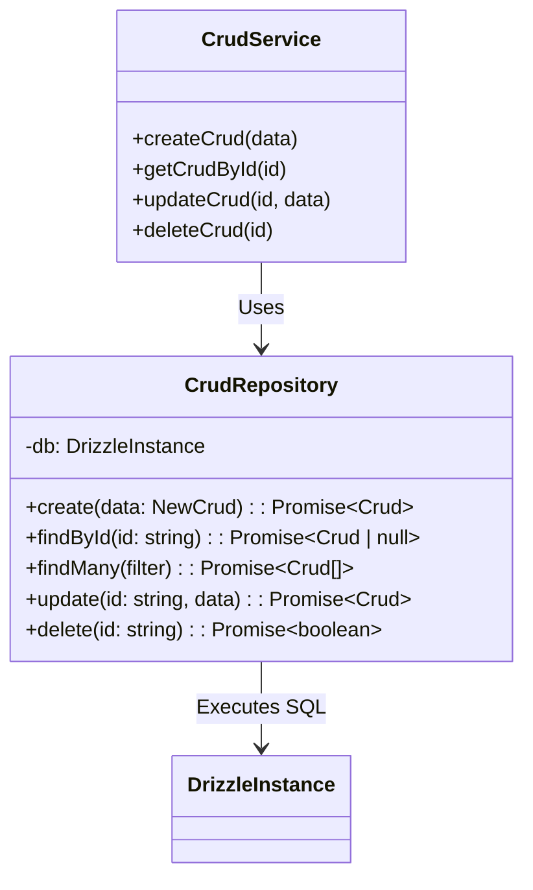

# 🗄️ Analisis Referensi: Database Layer & Repository Pattern

Dokumen ini membedah konfigurasi multi-database, Drizzle ORM, pemodelan skema relasional, dan implementasi Repository Pattern pada starter kit eksisting.

---

## 1. Multi-Database Architecture & Named Connections

Starter kit dirancang agnostik terhadap jenis database, dengan SQLite sebagai driver default untuk pengembangan lokal instan (*zero external dependency*), serta adapter siap pakai untuk MySQL, PostgreSQL, dan MongoDB.

Setiap jenis database mendukung **Multiple Named Connections (1, 2, 3)** secara bersamaan:
- **SQLite:** `sqlite1`, `sqlite2`, `sqlite3` (dikelola via `src/database/sqlite.connection.ts`)
- **MySQL:** `mysql1`, `mysql2`, `mysql3` (dikelola via `src/database/mysql.connection.ts`)
- **PostgreSQL:** `pg1`, `pg2`, `pg3` (dikelola via `src/database/pg.connection.ts`)
- **MongoDB:** `mongo1`, `mongo2`, `mongo3` (dikelola via `src/database/mongo.connection.ts`)

```text
src/database/
├── index.ts                  # Export koneksi aktif & helper database
├── drizzle.ts                # Inisialisasi instance Drizzle ORM
├── sqlite.connection.ts      # Multi-koneksi SQLite (sqlite1..3)
├── mysql.connection.ts       # Multi-koneksi MySQL (mysql1..3)
├── pg.connection.ts          # Multi-koneksi PostgreSQL (pg1..3)
├── mongo.connection.ts       # Multi-koneksi MongoDB (mongo1..3)
└── schema/                   # Definisi tabel Drizzle ORM
    └── example/
        └── crud.schema.ts    # Tabel relasional domain example
```

### Karakteristik Drizzle ORM:
- **Zero-overhead / SQL-like query builder:** Bebas dari abstraksi runtime yang berat, langsung memetakan query ke native SQL.
- **TypeScript Type Inference:** Skema tabel (`sqliteTable`) otomatis menghasilkan tipe data TypeScript untuk `Select` dan `Insert`:
  ```typescript
  export type Crud = typeof cruds.$inferSelect;
  export type NewCrud = typeof cruds.$inferInsert;
  ```

---

## 2. Repository Pattern Implementation

Repository bertindak sebagai gerbang tunggal antara domain bisnis (*Service*) dan database.



### Keunggulan Desain:
1. **Isolasi Query:** Kueri Drizzle ORM terkonsentrasi hanya di file `*.repository.ts`.
2. **Kemandirian Service:** Service hanya menerima dan memproses data murni, mempermudah pembuatan mock saat unit testing.
3. **Kemudahan Transaksi:** Memungkinkan pengelolaan transaksi database secara terpusat tanpa membocorkan detail ORM ke controller.

---

## 3. Database Migration & Seeding Lifecycle

Sistem migrasi dan seeding diatur oleh script CLI mandiri:
- **Migrasi (`scripts/migrate.ts`):** Menggunakan Drizzle Migrator untuk menjalankan file SQL di folder `scripts/migrations/`.
- **Seeder (`scripts/seed.ts`):** Mengisi data awal dummy ke dalam tabel menggunakan generator di `scripts/seeders/`.
- Perintah CLI:
  - `bun run db:migrate` — Menjalankan migrasi database.
  - `bun run db:seed` — Menjalankan database seeders.
  - `bun run db:reset` — Mengosongkan database dan menjalankan migrasi ulang + seeder.
