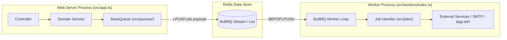

# ⚡ Analisis Referensi: Queue System & Background Workers

Dokumen ini membedah arsitektur sistem antrean asinkron (*asynchronous background jobs*) berbasis **BullMQ + Redis**, pemisahan proses worker, dan propagasi konteks pelacakan (*tracing*).

---

## 1. Arsitektur Antrean Terdistribusi (BullMQ + Redis)

Starter kit menggunakan **BullMQ** di atas Redis untuk memindahkan proses komputasi berat atau operasi I/O lambat (seperti pengiriman email, ekspor data, atau pemrosesan batch) keluar dari siklus request-response HTTP:



---

## 2. Struktur Job & Base Queue

1. **Base Queue Abstraction (`src/queues/base.queue.ts`):**
   - Mengelola koneksi Redis mandiri khusus antrean.
   - Mengatur konfigurasi default:
     - `attempts: 3` (Maksimal 3x percobaan ulang jika gagal).
     - `backoff: { type: "exponential", delay: 1000 }` (Retry bertahap dengan jeda eksponensial).
     - `removeOnComplete: true` / `removeOnFail: false` (Menyimpan riwayat error pada Redis untuk audit).
2. **Job Definition (`src/jobs/<domain>/<name>.job.ts`):**
   - Setiap job memiliki nama unik dan tipe data payload yang terdefinisi ketat.
   - Contoh: `SendEmailJob` menerima payload serializable:
     ```typescript
     export interface SendEmailJobPayload {
       to: string;
       subject: string;
       html: string;
       correlationId?: string;
     }
     ```

---

## 3. Worker Lifecycle & Context Tracing

Sistem worker dapat dijalankan terpisah atau bersamaan dengan HTTP server:
- Entry point worker: `src/workers/index.ts`.
- **Propagasi Context:** Sebelum job dieksekusi oleh worker, `correlationId` yang disimpan di dalam payload job diekstraksi dan dibungkus kembali ke dalam `requestContext.run()`:
  ```typescript
  await requestContext.run({ requestId: job.data.correlationId ?? crypto.randomUUID() }, async () => {
    logger.info(`Processing job ${job.name} [ID: ${job.id}]`);
    await handleJob(job);
  });
  ```
- Dengan cara ini, semua log yang dihasilkan di dalam background job tetap memiliki ID pelacakan yang sama dengan request HTTP awal yang memicunya.
- **Graceful Worker Shutdown:** Saat menerima sinyal `SIGTERM`, worker berhenti menerima job baru dan menunggu job yang sedang aktif selesai diproses sebelum menghentikan proses.
