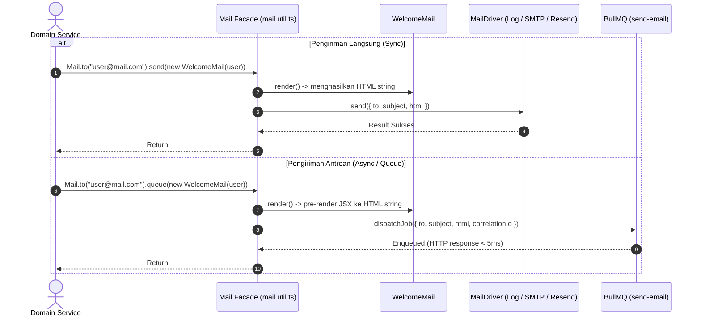

# ✉️ Analisis Referensi: Laravel-Style Mail System & Templating

Dokumen ini membedah arsitektur pengiriman email ala Laravel yang diterapkan di starter kit, mencakup Mailable class, template engine Hono JSX, transport drivers, dan facade fluent builder.

---

## 1. Arsitektur Komponen Mail System

Sistem email memisahkan peran konten, presentasi tampilan, transport protokol, dan orkestrasi pengiriman:

```text
src/
├── mail/                     # Definisi Mailable Class (Domain)
│   ├── mailable.ts           # Kontrak dasar & interface Mailable
│   └── Welcome.mail.ts       # Contoh class email konkret
├── libraries/mail/           # Technical Driver Adapters
│   └── drivers/
│       ├── mail.driver.ts    # Interface MailDriver & factory
│       ├── log.driver.ts     # Driver logging (dev/testing)
│       ├── smtp.driver.ts    # Driver SMTP (Nodemailer)
│       └── resend.driver.ts  # Driver Resend API
├── utils/
│   └── mail.util.ts          # Mail facade & fluent builder (Mail.to)
resources/views/emails/       # Template HTML Email
├── layouts/
│   └── EmailLayout.tsx       # Layout dasar email responsif
└── WelcomeEmail.tsx          # Komponen template JSX konkret
```

---

## 2. Alur Pengiriman: Sinkron vs Antrean Asinkron



---

## 3. Fitur Utama Mail System:
1. **Pre-rendering JSX Sebelum Enqueue:**
   - Template JSX dirender menjadi string HTML statis sebelum dimasukkan ke dalam antrean Redis. Hal ini mencegah kegagalan serialisasi class/fungsi di sisi worker BullMQ.
2. **Multi-Driver Transport:**
   - `log`: Mencetak isi email lengkap dengan box ASCII ke console/log. Sangat aman untuk staging, CI, dan local dev tanpa khawatir salah kirim email ke user sungguhan.
   - `smtp`: Menggunakan protokol SMTP standar melalui Nodemailer.
   - `resend`: Mengirim email via modern REST API Resend.
3. **Fluent API:**
   - Sintaks ergonomis ala Laravel: `await Mail.to("user@test.com").queue(new WelcomeMail({ name: "John" }))`.
